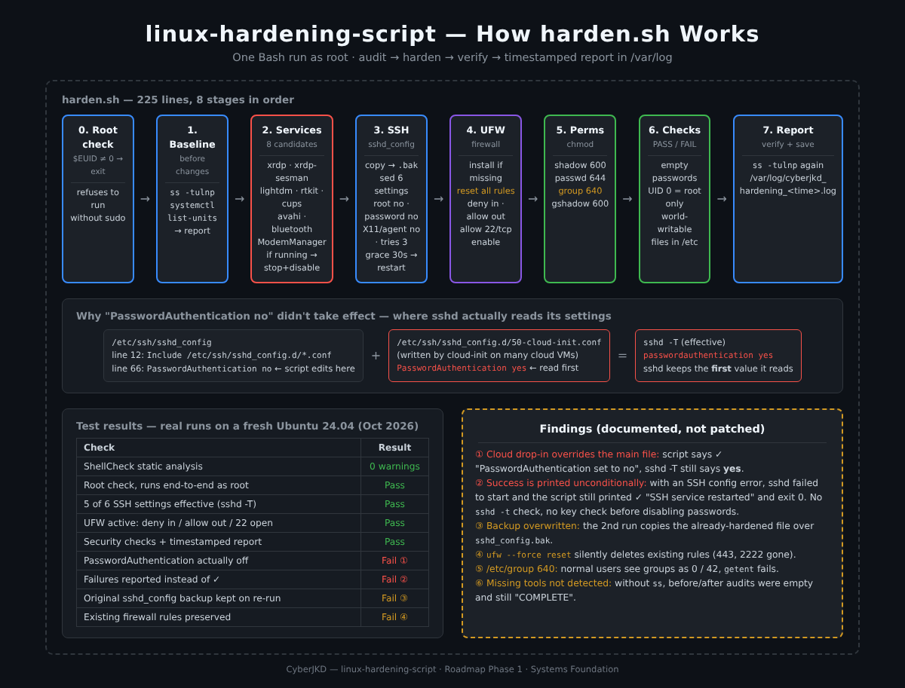
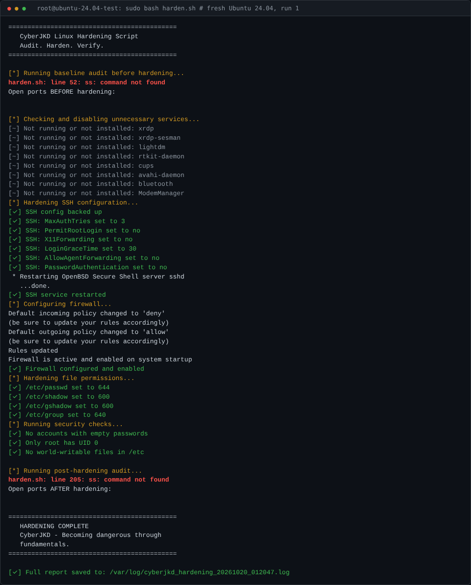
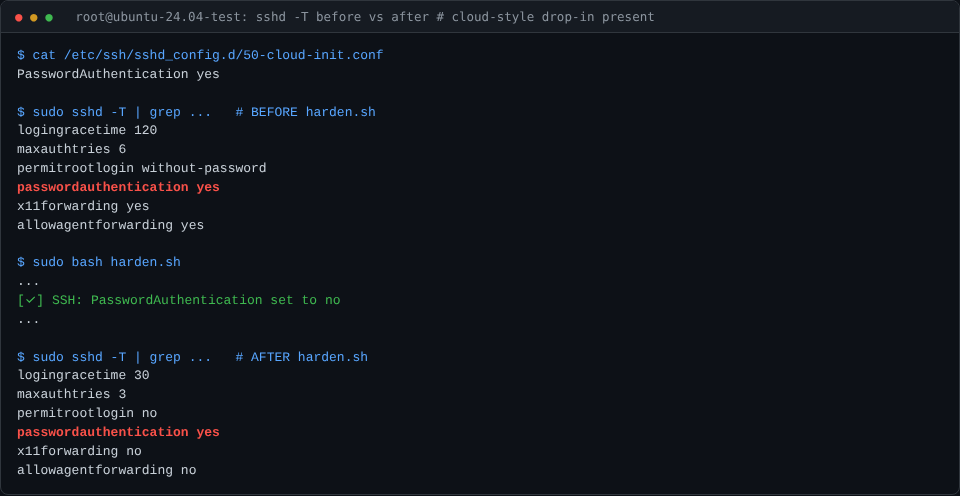
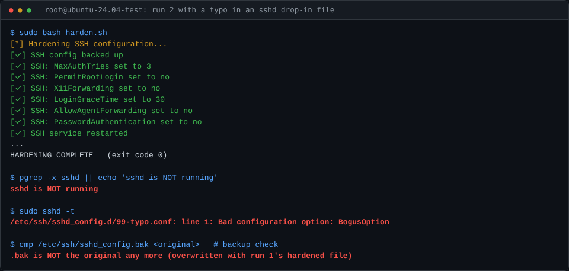
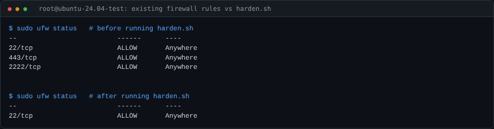
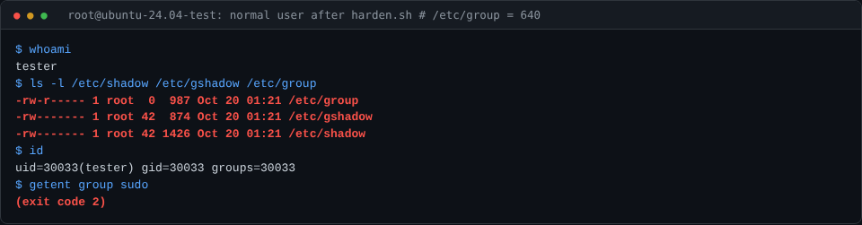

# CyberJKD Linux Hardening Script - Audit. Harden. Verify.


| | |
|---|---|
| **Author** | Dalla Samuel (CyberJKD) |
| **Written** | March 23, 2026 |
| **Language** | Bash (`harden.sh`, 225 lines) |
| **Tested on** | Kali Linux (WSL2) · Ubuntu Server 24.04 (VirtualBox VM) · fresh Ubuntu 24.04 (October 2026 re-test) |
| **Roadmap** | Phase 1 · Systems Foundation |
| **Built from** | [linux-hardening-lab](https://github.com/DallaSamuel/linux-hardening-lab) (manual version of the same checklist) |

---

## Objective

Turn the manual [Linux hardening lab](https://github.com/DallaSamuel/linux-hardening-lab) into one script that audits, hardens and verifies a Debian-based Linux system in a single run and leaves a timestamped report behind as evidence.

The script follows the same principle as the lab: **audit first, harden second, verify third.**

> **The script is kept exactly as I wrote it in March 2026.** In October 2026 I re-tested it on a fresh Ubuntu 24.04 system the way I'd test someone else's tool, and documented what holds up and what doesn't (see [Findings](#findings)). Knowing where your own automation fails is part of the job.

## Business Problem

Hardening servers by hand is slow and inconsistent. Two admins following the same checklist end up with two different servers, and nobody can prove later what was changed. A script applies the same baseline every time, and a report records what was done and when. That is the core idea behind configuration management tools like Ansible and behind CIS Benchmark automation, at a beginner scale.

## Environment

| Component | Value |
|---|---|
| Shell | Bash 4+ (uses associative arrays) |
| Targets | Debian-based Linux: Kali, Ubuntu, Debian |
| Needs | root (`sudo`), `systemctl`, `ss` (iproute2), `apt` |
| Changes | systemd services, `/etc/ssh/sshd_config`, UFW rules, account file permissions |
| Output | Console (coloured) + `/var/log/cyberjkd_hardening_YYYYMMDD_HHMMSS.log` |

## Key Concepts

- **Idempotent automation**: a script that can be run again safely and ends in the same state. This one *mostly* is (see Finding 3).
- **Associative arrays**: `declare -A` maps each SSH setting or file to its value, so adding a control is a one-line change.
- **In-place config editing**: `sed -i "s/^#*Key.*/Key value/"` replaces a setting whether or not it's commented out, and appends it if it's missing.
- **Effective vs written configuration**: what's in a file isn't always what a service uses. `sshd -T` prints the settings SSH actually applies (see Finding 1).
- **Default-deny firewall**: UFW denies all inbound traffic except SSH.
- **Evidence by default**: every action is written to a timestamped log, so there's a record for review or audit.

## Architecture



```
sudo bash harden.sh
   │
   ├── 0. Root check        → exit if $EUID ≠ 0
   ├── 1. Baseline audit    → ss -tulnp + running services → report
   ├── 2. Services          → stop + disable if running: xrdp, xrdp-sesman, lightdm, rtkit-daemon,
   │                          cups, avahi-daemon, bluetooth, ModemManager
   ├── 3. SSH               → back up sshd_config → set 6 settings with sed → restart ssh
   │                          PermitRootLogin no · PasswordAuthentication no · X11Forwarding no
   │                          MaxAuthTries 3 · LoginGraceTime 30 · AllowAgentForwarding no
   ├── 4. Firewall          → install ufw if missing → reset → deny in / allow out / allow ssh → enable
   ├── 5. File permissions  → /etc/shadow 600 · /etc/passwd 644 · /etc/group 640 · /etc/gshadow 600
   ├── 6. Security checks   → empty passwords · UID 0 accounts · world-writable files in /etc (PASS/FAIL)
   └── 7. Post audit        → ss -tulnp again → /var/log/cyberjkd_hardening_<timestamp>.log
```

## What It Does

| Stage | Action | Logged as |
|---|---|---|
| Baseline | Records listening ports and running services before any change | `---- BASELINE AUDIT ----` |
| Services | Stops and disables 8 commonly unneeded services if they're running, and skips the rest | `[DISABLED]` / `[SKIPPED]` |
| SSH | Backs up `sshd_config`, sets 6 hardened values, restarts SSH | `[BACKUP]`, `[SSH]` |
| Firewall | Installs UFW if needed, default deny incoming, allow outgoing, allow SSH, enable | `[UFW]` |
| Permissions | Sets permissions on the 4 account files | `[PERMS]` |
| Checks | Empty passwords, extra UID 0 accounts, world-writable files in `/etc` | `[CHECK] … PASS/FAIL` |
| Post audit | Records listening ports again to confirm the reduced attack surface | `---- POST-HARDENING AUDIT ----` |

## Usage

```bash
git clone https://github.com/DallaSamuel/linux-hardening-script.git
cd linux-hardening-script
sudo bash harden.sh

# Read the report
sudo ls /var/log/cyberjkd_hardening_*.log
sudo cat /var/log/cyberjkd_hardening_<timestamp>.log
```

> ⚠️ **Before running on a remote server:** the script turns off SSH password login. Make sure your SSH **key** works first and keep your current session open, or you can lock yourself out. Read [Findings](#findings) first.

## Sample Output

Original run (Kali Linux on WSL2, March 23, 2026):

```
============================================
   CyberJKD Linux Hardening Script
   Audit. Harden. Verify.
============================================
[*] Running baseline audit before hardening...
[*] Checking and disabling unnecessary services...
[✓] Disabled: rtkit-daemon
[~] Not running or not installed: xrdp
[*] Hardening SSH configuration...
[✓] SSH config backed up
[✓] SSH: PermitRootLogin set to no
[✓] SSH: PasswordAuthentication set to no
[✓] SSH: MaxAuthTries set to 3
[✓] SSH service restarted
[*] Configuring firewall...
[✓] Firewall configured and enabled
[*] Hardening file permissions...
[✓] /etc/shadow set to 600
[✓] /etc/passwd set to 644
[*] Running security checks...
[✓] No accounts with empty passwords
[✓] Only root has UID 0
[✓] No world-writable files in /etc
[*] Running post-hardening audit...
============================================
   HARDENING COMPLETE
   CyberJKD - Becoming dangerous through
   fundamentals.
============================================
[✓] Full report saved to: /var/log/cyberjkd_hardening_20260323_000903.log
```

October 2026 re-test on a fresh Ubuntu 24.04 system:



## Verification Checklist

Re-tested in October 2026 by running the unmodified `harden.sh` as root on a fresh Ubuntu 24.04 system, checking the *effective* result of each step rather than the script's own messages.

- [x] ShellCheck static analysis: **0 warnings**
- [x] Refuses to run without root
- [x] SSH: `PermitRootLogin no`, `MaxAuthTries 3`, `X11Forwarding no`, `LoginGraceTime 30`, `AllowAgentForwarding no` confirmed with `sshd -T`
- [x] UFW active: default deny incoming, allow outgoing, only 22/tcp allowed
- [x] Security checks run and the timestamped report is written to `/var/log`
- [ ] SSH password login is actually off: **fails on cloud-style systems, see Finding 1**
- [ ] Failed steps are reported as failures: **fails, see Finding 2**
- [ ] Original `sshd_config` backup survives a second run: **fails, see Finding 3**
- [ ] Existing firewall rules are preserved: **fails, see Finding 4**

## Findings

**1. `PasswordAuthentication no` can be silently overridden (security).** Modern Ubuntu and Debian load drop-in files from `/etc/ssh/sshd_config.d/` near the *top* of `sshd_config` (`Include` on line 12), and `sshd` keeps the **first** value it reads. Cloud images often ship a drop-in such as `50-cloud-init.conf` containing `PasswordAuthentication yes` (cloud-init writes it when a VM is created with password login). In the test, the script printed `[✓] SSH: PasswordAuthentication set to no`, but `sshd -T` still reported **`passwordauthentication yes`**. The main file was changed, but SSH ignored it.
*Fix:* write settings to an early drop-in (e.g. `/etc/ssh/sshd_config.d/00-cyberjkd.conf`), or remove conflicting lines from the other drop-ins, then **verify with `sshd -T`** instead of trusting the edit.



**2. Success is printed even when a step fails (reliability).** There's no `set -e` and no exit-code checks, so every step prints `[✓]` regardless of what happened. With a typo in an SSH drop-in file (`BogusOption yes`), the restart failed and **`sshd` was left not running**, but the script printed `[✓] SSH service restarted`, finished with `HARDENING COMPLETE` and exited with code 0. On a remote server, that means no new SSH logins. Related: the script disables password login without checking that the admin has a working SSH key, and never runs `sshd -t` to validate the config before restarting.
*Fix:* check every command's result, run `sshd -t` before restarting, refuse to disable passwords if no `authorized_keys` exists for an admin user, and end with a non-zero exit code if anything failed.



**3. The backup is overwritten on the next run (idempotency).** `cp sshd_config sshd_config.bak` runs every time. On the second run, the "backup" is the already-hardened file and the original is gone.
*Fix:* add a timestamp to the backup (`sshd_config.bak.20261020_012047`), or only create it if it doesn't exist yet.

**4. `ufw --force reset` deletes existing firewall rules (availability).** The script wipes every UFW rule before adding its own. In the test, rules for `443/tcp` (HTTPS) and `2222/tcp` existed before the run and were **gone** after it. On a web server that's an outage. If SSH runs on a non-standard port, it's a lockout.
*Fix:* don't reset. Add the required rules on top of existing ones, and detect the real SSH port from `sshd -T` instead of assuming 22.



**5. `/etc/group` set to 640 (usability).** Same issue as in the [lab](https://github.com/DallaSamuel/linux-hardening-lab#review-notes-october-2026). Normal users can no longer read group names: `ls -l` shows groups as `0` and `42`, `id` can't name the user's own group, and `getent group` fails. The distro defaults (`/etc/group` 644, `/etc/shadow` and `/etc/gshadow` 640 `root:shadow`) already keep password hashes away from normal users.



**6. Missing tools aren't detected (robustness).** On a minimal system without `ss` (the `iproute2` package), both port audits printed `ss: command not found`, the report's before and after sections were empty, and the run still ended with `HARDENING COMPLETE`. Smaller notes:
- the report in `/var/log` is world-readable (644);
- services that are enabled but not running at the time are skipped, so they still start on the next boot;
- socket-activated services such as `cups.socket` can bring a disabled service back.

*Fix:* check for required commands at the start, `chmod 600` the report, and use `systemctl disable --now` on the service and its `.socket` unit whether or not it's running.

## What I'd Change for Production

- **Verify the effective state, not the edit**: `sshd -T`, `ufw status`, `stat` after each step, and report PASS/FAIL from that (Findings 1, 2).
- **Fail loudly**: `set -euo pipefail`, an exit-code check per step, a non-zero exit when anything fails, and a clear summary at the end.
- **Safety rails for SSH**: `sshd -t` before restart, an SSH key check before disabling passwords, and automatic rollback if the service doesn't come back.
- **Don't destroy existing state**: no `ufw reset`, timestamped backups, and a `--dry-run` mode that shows what would change (Findings 3, 4).
- **Distro-default permissions** for the account files (Finding 5).
- **Benchmark against a standard**: map each control to a CIS Benchmark ID and run **Lynis** before and after to measure improvement.
- **Graduate to config management**: the same controls as an **Ansible** role, which is idempotent by design, tested on throwaway VMs or containers in CI.

## Connection to Roadmap

This script is part of **Phase 1 · Systems Foundation** of the [CyberJKD Roadmap](https://dallasamuel.github.io/CyberJKD-Roadmap):

1. **[linux-hardening-lab](https://github.com/DallaSamuel/linux-hardening-lab)**: the manual hardening of Kali Linux on WSL2 (March 14, 2026).
2. **linux-hardening-script** (this repo): the same checklist automated (March 23, 2026).
3. **[Linux Hardening Lab (VM)](https://github.com/DallaSamuel/CyberJKD-Labs/tree/main/phase-01/project-01-linux-hardening)**: manual hardening of an Ubuntu Server 24.04 VM, then this script deployed and run on it (CyberJKD-Labs Phase 01 · Project 01).

## License

[MIT](LICENSE)

---

🌐 Full roadmap: [dallasamuel.github.io/CyberJKD-Roadmap](https://dallasamuel.github.io/CyberJKD-Roadmap)

🔗 All labs: [github.com/DallaSamuel/CyberJKD-Labs](https://github.com/DallaSamuel/CyberJKD-Labs)

👤 GitHub profile: [@DallaSamuel](https://github.com/DallaSamuel) · LinkedIn: [dallasamuel](https://www.linkedin.com/in/dallasamuel)

---

*CyberJKD - Becoming dangerous through fundamentals. 🔒*
